# GrafikaKu Design System & UI/UX Guidelines (design.md)

Dokumen ini adalah acuan baku (**Design System & UI/UX Specification**) untuk perancangan, pengembangan antarmuka, dan integrasi fitur pada website **GrafikaKu**. Setiap penambahan halaman, komponen baru, refactoring, atau interaksi wajib mematuhi aturan di dalam dokumen ini agar konsistensi visual, aksesibilitas, dan alur pembelajaran tetap selaras dengan wireframe `Section 1.png` dan dokumen acuan kurikulum SMK DKV.

---

## 1. Fondasi Desain & Atribut Sistem (Design Tokens)

Berdasarkan *Proposal GrafikaKu Revisi (Tabel 15)* dan wireframe *Hi-Fi Section 1.png*:

### 1.1 Palet Warna Resmi (Color Palette)
| Token Nama | Hex Code | Karakteristik / Penerapan |
|---|---|---|
| `--navy` (Primary) | `#183359` | Navbar header, judul halaman, teks tegas, border fokus, tombol sekunder |
| `--navy-dark` | `#0F172A` | Background kontras tinggi, teks hitam pekat, footer background |
| `--accent-gold` (CTA) | `#EB8C34` / `#F59E0B` | Tombol aksi utama (CTA): *Mulai Belajar*, *Periksa Jawaban*, *Unduh File Latihan* |
| `--accent-hover` | `#D97706` | Hover state tombol CTA utama |
| `--bg-body` | `#F8FAFC` | Latar belakang utama halaman (clean, soft grey-white) |
| `--card-bg` | `#FFFFFF` | Latar kartu konten materi, card evaluasi |
| `--border` | `#E2E8F0` | Garis pembatas kartu, separator, input border |
| `--text-main` | `#1E293B` | Teks paragraf utama (rasio kontras $\ge 4.5:1$ WCAG AA) |
| `--text-muted` | `#64748B` | Teks keterangan, caption, subjudul pendukung, breadcrumb |
| `--success` / `--green` | `#3E9660` / `#0E9F6E` | Status tuntas, jawaban benar, indikator terbuka |
| `--success-light` | `#DEF7EC` / `#E5F3EA` | Background umpan balik benar / kartu tuntas |
| `--danger` / `--red` | `#DC2626` / `#E02424` | Status belum tepat, peringatan validasi input kosong |
| `--danger-light` | `#FDE8E8` / `#FEE2E2` | Background umpan balik salah / perlu perbaikan |

### 1.2 Palet Modul Materi (Module Identification Colors)
Untuk membedakan 3 modul secara visual sesuai storyboard:
- **Modul 1 (Prinsip Desain):** Latar kartu lembut `#DEEBFA` (Soft Indigo/Blue)
- **Modul 2 (Software Desain):** Latar kartu lembut `#E5F3EA` (Soft Mint/Green)
- **Modul 3 (Komunikasi Visual):** Latar kartu lembut `#FAE9D6` (Soft Warm Peach/Orange)

### 1.3 Tipografi (Typography)
- **Huruf Judul (Headings):** `'Poppins', sans-serif` (SemiBold 600, Bold 700, ExtraBold 800)
- **Huruf Konten (Body/Paragraf/Label):** `'Inter', 'Open Sans', sans-serif` (Regular 400, Medium 500, SemiBold 600)
- **Skala Ukuran Huruf:**
  - `H1` (Hero / Judul Modul Utama): `24px – 28px` (Mobile: `22px`), Line-height: `1.3`
  - `H2` (Judul Subtopik / Section): `18px – 20px`, Line-height: `1.4`
  - `H3` (Nama Modul / Judul Kartu): `16px – 18px`, Line-height: `1.4`
  - `Body / Paragraf Deskripsi`: `14px – 16px`, Line-height: `1.6`
  - `Keterangan / Badge / Caption`: `12px – 13px`, Line-height: `1.4`

### 1.4 Bentuk, Spasi, & Elevasi (Shapes & Shadows)
- **Border Radius:**
  - Kartu Konten (`.card`): `10px – 12px`
  - Tombol Utama & Opsi Kuis: `8px`
  - Badge / Status Pill: `99px` (Pill radius penuh)
- **Shadows:**
  - Card default: `0 2px 8px rgba(0, 0, 0, 0.04), 0 1px 2px rgba(0, 0, 0, 0.06)`
  - Card hover / Active popover: `0 8px 20px rgba(0, 0, 0, 0.08)`
  - Tombol Primary CTA: `0 2px 4px rgba(235, 140, 52, 0.25)`

---

## 2. Struktur Komponen & Pola Tata Letak (Component Patterns)

Sesuai urutan 10 layar pada wireframe `Section 1.png`:

```mermaid
flowchart LR
    A["1. Beranda"] --> B["2. CP & TP"]
    B --> C["3. Modul 1 (9 Prinsip)"]
    C --> D["4. Latihan 1 (Emphasis)"]
    D --> E["5. Kuis Modul 1 (10 Soal)"]
    E --> F["6. Modul 2 (Software SOP)"]
    F --> G["7. Latihan 2 (Unduh Berkas)"]
    G --> H["8. Modul 3 (Alur Komunikasi)"]
    H --> I["9. Proyek Mini (Poster)"]
    I --> J["10. Lencana Kelulusan (Hasil Akhir)"]
```

### 2.1 Navigation Bar (Top Sticky Navbar)
- **Komponen:**
  - Logo GrafikaKu di sebelah kiri: Badge kotak `[G]` warna oranye + teks *"GrafikaKu"* + label kecil *"Media Belajar"*.
  - Link Menu: `Beranda`, `Modul 1`, `Modul 2`, `Modul 3`, `Latihan`, `Kuis`, `CP & TP`, `Glosarium`.
  - Icon Hamburger Menu di sebelah kanan untuk layar ponsel ($\le 768\text{px}$).
- **Perilaku:**
  - Navigasi bertindak sebagai Single Page Application (SPA routing hash).
  - State aktif ditandai garis aksen di bawah menu atau background semi-transparan.

### 2.2 Breadcrumb Navigation
- Setiap halaman modul materi dan evaluasi **wajib** menyertakan breadcrumb di bagian atas:
  `Beranda / Modul [Nomor] / [Nama Subtopik / Aktivitas]`
- Berfungsi untuk menjaga orientasi pengguna agar tidak tersesat dalam hierarki materi.

### 2.3 Kartu Modul & Indikator Status (Module Card & Lock Gate)
- Menampilkan:
  - Nomor modul di dalam badge bulat (`1`, `2`, `3`).
  - Judul modul dan ringkasan cakupan materi.
  - **Status Pill:**
    - Terbuka: badge hijau `[✓ Terbuka]`.
    - Terkunci: badge merah/abu `[🔒 Terkunci]`.
  - **Progress Bar:** Menampilkan persentase selesai (`%`) secara dinamis.

---

## 3. Aturan Desain Halaman Spesifik (Page Rules)

### 3.1 Layar 1: Beranda (`#beranda`)
1. **Hero Box:** Sapaan pembuka, tujuan web, dan tombol CTA utama:
   `[Mulai Belajar →]` yang mengarahkan ke halaman `#cptp`.
2. **Daftar Kartu Modul:** 3 kartu berjejer vertikal/grid untuk Modul 1, Modul 2, dan Modul 3.
3. **Quick Bar Bawah:** Tautan cepat menuju Glosarium (Akordion) dan panduan CP/TP.

### 3.2 Layar 2: Capaian & Tujuan Pembelajaran (`#cptp`)
1. Menyajikan elemen resmi Kurikulum Merdeka Fase F: TP 1, TP 2, TP 3.
2. **Pemanasan Interaktif (Warmup):** Kartu pencocokan istilah desain ke definisinya sebelum masuk modul.
3. Tombol aksi di bawah: `[Mulai Modul 1: Prinsip Desain →]`.

### 3.3 Layar 3: Modul 1 — 9 Prinsip Desain (`#modul1`)
1. **Tab Navigasi 9 Prinsip:** Tab berurutan (1. Unity s.d. 9. White Space).
2. **Kanvas Contoh Karya Beranotasi (F04):**
   - Menampilkan ilustrasi SVG karya desain.
   - Dilengkapi hotspot pin interaktif (`1`, `2`, `3`) dengan animasi *pulse*.
   - Saat pin diklik, popover anotasi muncul di atas karya tanpa menutupi elemen lain.
3. **Toggle Simetris / Asimetris:** Khusus pada prinsip *Balance*, tombol toggle wajib tersedia.
4. **Kotak Kata Kunci & Catatan Menghindari Kesalahan:** Kotak panduan ringkas di bawah kanvas.
5. **Navigasi Bawah:** Tombol `< Sebelumnya` dan `Berikutnya >` disertai titik pagination (dots indicator).

### 3.4 Layar 4 & 7: Latihan Interaktif (`#latihan`)
1. **Latihan Menandai Penekanan (F09):**
   - **Aturan Interaksi Wajib:** Siswa **harus mengklik langsung elemen pada kanvas gambar**, bukan memilih kartu pilihan ganda A/B biasa!
   - Cincin penanda fokus (`markerRing`) harus muncul melingkari elemen yang diklik.
   - Jika tombol *Periksa Jawaban* ditekan tanpa mengklik gambar, **wajib** muncul pesan validasi merah: *"Silakan klik langsung pada salah satu elemen karya di kanvas untuk menandai bagian penekanan!"*.
2. **Latihan Urutan SOP (F09-2):**
   - Komponen pengurutan tahap kerja software (Buat Kanvas $\rightarrow$ Susun Objek $\rightarrow$ Simpan Master $\rightarrow$ Ekspor PNG).

### 3.5 Layar 5: Kuis Evaluasi 10 Soal (`#kuis`)
1. **Struktur Kuis:**
   - 10 butir soal pilihan ganda kurikulum resmi GrafikaKu.
   - Indikator: `Soal X dari 10` dan progress bar persentase pengerjaan.
2. **Aturan Validasi Input:**
   - Jika pengguna menekan tombol *Soal Berikutnya* / *Kumpulkan* tanpa memilih salah satu opsi, sistem **tidak boleh melanjutkan** dan **wajib** menampilkan peringatan: *"Silakan pilih salah satu opsi jawaban terlebih dahulu sebelum melanjutkan!"*.
3. **Aturan Ambang Ketuntasan 75 & Gerbang Modul (F10 & F14):**
   - Sistem menghitung skor dari 0 sampai 100.
   - Jika `Skor >= 75`:
     - Tampilkan layar hasil tuntas: lencana hijau `[✓]`, skor akhir, ucapan selamat.
     - Simpan `localStorage.setItem('grafikaku_modul2_unlocked', 'true')`.
     - Buka kunci Modul 2 & Modul 3 secara permanen (tetap terbuka saat refresh).
     - Tombol aksi: `[Mulai Belajar Modul 2 Sekarang →]`.
   - Jika `Skor < 75`:
     - Tampilkan layar belum tuntas: icon peringatan `[⚠]`, skor akhir, dan instruksi peninjauan ulang.
     - Sediakan tombol `[↺ Ulangi Kuis]` dan `[Tinjau Materi Modul 1]`. Modul 2 tetap terkunci.

### 3.6 Layar 6 & 7: Modul 2 — Software Desain & SOP (`#modul2`)
1. **Eksplorasi Antarmuka (F05):** Interaktif toolbox, kanvas kerja, dan layer properties.
2. **Pemutar Video Tutorial (F07):** Video panduan bertahap dengan kontrol pemutaran.
3. **Panduan 6 Langkah SOP (F06):** Langkah baku persiapan, pembuatan, penyimpanan `.psd`/`.cdr`, dan ekspor.
4. **Unduh File Latihan (F11):** Tombol oranye wajib mengunduh file aset nyata: `AS10_Tumbler_Latihan.svg`.

### 3.7 Layar 8 & 9: Modul 3 — Alur Komunikasi & Proyek Mini (`#modul3`)
1. **Bagan Alur Komunikasi Visual (F08):**
   - 4 tahapan berurutan: `Komunikator` $\rightarrow$ `Pesan` $\rightarrow$ `Media` $\rightarrow$ `Komunikan`.
   - Slot interaktif penempatan label dan tombol *Periksa Alur*.
2. **Brief Proyek Mini (Section 1 Wireframe):**
   - Brief perancangan poster tumbler/edukasi SMK dengan rubrik penilaian mandiri.

### 3.8 Layar 10: Lencana Emas Kelulusan (Hasil Akhir)
- Tampilan pencapaian akhir berupa **Lencana Bintang/Emas**, rekap skor akhir per TP, dan tombol kembali ke Beranda.

### 3.9 Komponen Glosarium Desain (Modal Akordion / F12)
- Dibuka dari menu navbar atau tautan Beranda.
- **Wajib menggunakan format akordion (collapsible):** Judul istilah dan kategori terlihat, keterangan dan contoh penerapan tersembunyi dan baru terbuka saat judul diklik.
- Dilengkapi input pencarian instan (filter istilah langsung saat mengetik).

---

## 4. Standar Responsivitas & Aksesibilitas (Responsive & WCAG)

### 4.1 Breakpoints
| Lebar Layar | Kategori | Penyesuaian Tata Letak |
|---|---|---|
| `< 480px` | Ponsel Kecil (360px) | Single column, padding 14px, ukuran font judul 20px, touch target $\ge 44\text{px}$ |
| `481px – 768px` | Tablet / Ponsel Lebar | Hamburger menu aktif, grid modul 1 kolom, toggle button full width |
| `769px – 1024px` | Tablet Horizontal / Laptop Kecil | Hamburger menu nonaktif, menu horizontal, grid 2 kolom |
| `> 1024px` | Desktop Standar (1366px) | Max container `1120px` centered, grid 3 kolom modul, layout leluasa tanpa horizontal scroll |

### 4.2 Aksesibilitas & Mayer Coherence Principles
- **Touch Target:** Semua tombol dan link minimal `44px x 44px`.
- **Rasio Kontras:** Teks terhadap background minimal `4.5:1` (WCAG AA). Teks di atas warna aksen oranye menggunakan warna putih tebal atau navy pekat.
- **Koherensi Mayer:** Hindari dekorasi grafis yang tidak relevan dengan materi agar beban kognitif siswa SMK tetap terfokus pada pesan pembelajaran.

---

## 5. Golden Rules untuk AI & Pengembang (Strict Development Rules)

1. **JANGAN PERNAH** mengubah tata letak menjadi multi-page (`.html` terpisah untuk setiap materi) tanpa instruksi tegas. Gunakan arsitektur **Single Page Application (SPA)** berbasis selektor `#id` dan kelas `.active`.
2. **JANGAN PERNAH** menghilangkan id elemen yang telah diuji pada test case (`#mod1ProgressBar`, `#modul2Card`, `#exerciseSvg`, `#markerRing`, `#quizQuestionContainer`, `#glossaryModal`, `#lockedModal`).
3. **SELALU** sinkronkan perubahan tampilan pada kedua berkas:
   - `index.html` (halaman produksi lokal)
   - `GrafikaKu — Web Alpha.html` (arsip web alpha)
4. **SELALU** simpan status ketercapaian siswa di `localStorage` menggunakan kunci:
   - `grafikaku_visited_principles`: array indeks prinsip yang telah dibaca (misal: `[0, 1, 2]`).
   - `grafikaku_modul2_unlocked`: bernilai string `'true'` jika nilai kuis $\ge 75$.
5. **JANGAN LAKUKAN GIT PUSH** otomatis kecuali diperintahkan secara eksplisit oleh pengguna.

